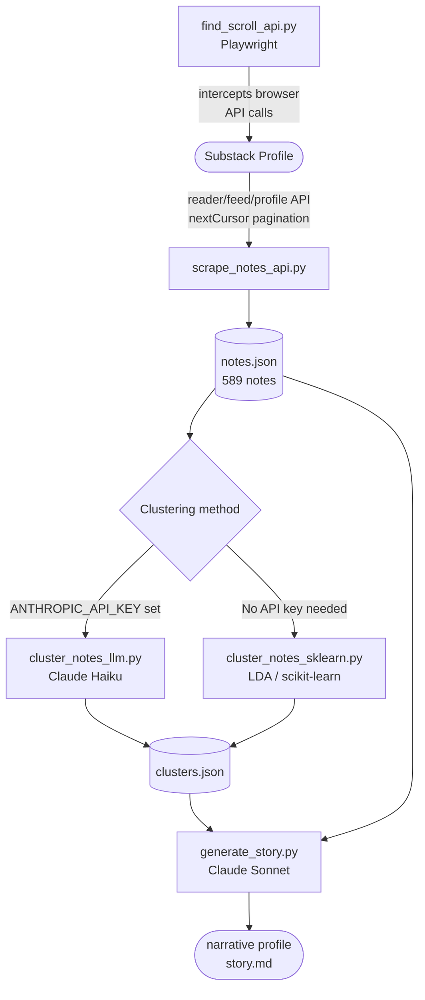

# Substack Intelligence Pipeline

A multi-stage pipeline that scrapes a Substack author's notes, clusters them semantically, and generates a longform narrative profile.

## Pipeline



## Setup

```bash
# Required for scraping private profiles:
export SUBSTACK_SESSION_COOKIE=your_substack_sid_cookie

# Required for Claude clustering and narrative generation:
export ANTHROPIC_API_KEY=your_key_here
```

Get `SUBSTACK_SESSION_COOKIE` from browser DevTools → Application → Cookies → `substack.com` → `substack.sid`.

## Usage

### 1. Scrape notes

```bash
python scrape_notes_api.py <user_id> <output_file>
# Example:
python scrape_notes_api.py 273636371 notes.json
```

Paginates through the full note history using the API's `nextCursor` field. The `user_id` is the numeric ID visible in the `reader/feed/profile/<user_id>` API path — inspect network requests on any profile's notes page to find it.

Output: `notes.json`

### 2a. Cluster with Claude (semantic)

```bash
python cluster_notes_llm.py notes.json
```

Sends all notes to Claude Haiku in a single prompt. Claude identifies 6-8 recurring topic clusters and returns structured JSON with engagement metrics per cluster.

Output: `clusters.json`

### 2b. Cluster with LDA (no API key)

```bash
pip install scikit-learn numpy
python cluster_notes_sklearn.py notes.json
```

Fits LDA topic models for n=5–10 topics, selects the best by perplexity elbow, and assigns each note to a cluster.

Output: `clusters.json`

### 3. Generate narrative

```bash
python generate_story.py notes.json clusters.json
```

Passes cluster themes and top-engagement notes to Claude Sonnet. Returns a 500–700 word analytical profile of the author.

Output: `story.md`

### API discovery tool

```bash
pip install playwright && playwright install chromium
python find_scroll_api.py <substack_handle>
```

Launches a headless browser, loads the notes page, scrolls, and logs every API call intercepted — useful for reverse-engineering new endpoints or pagination formats.

## How it works

**Scraping:** Substack's `reader/feed/profile` endpoint returns a `nextCursor` field with each response. The scraper follows that cursor page by page until it's absent, pulling the full history. Each page returns up to 25 items; notes appear as `type: "comment"` in the feed.

**Clustering:** Claude reads all notes in one prompt and groups them by semantic theme — conceptual similarity rather than keyword overlap. The LDA alternative uses bag-of-words term frequency with an extended stopword list tuned for social/political text.

**Narrative generation:** Claude Sonnet receives the cluster map and top-performing notes (ranked by reactions), then writes an analytical profile surfacing what resonates with the audience, what falls flat, and what tensions exist in the author's worldview.
