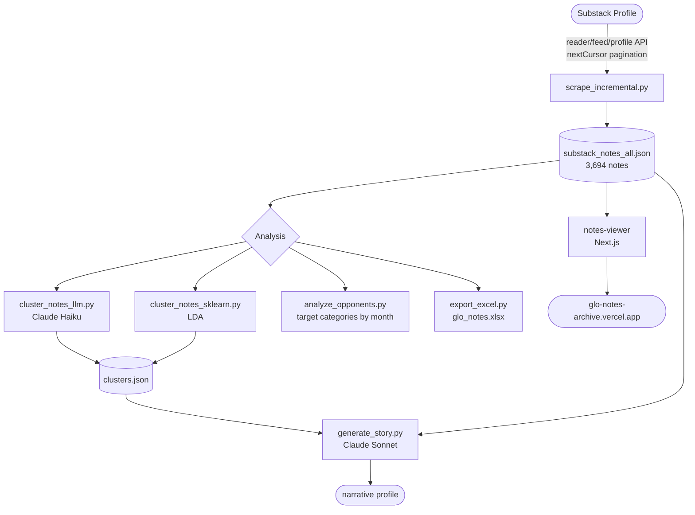

# Substack Intelligence Pipeline

Scrapes a Substack author's notes, analyses them, and publishes them as a
browsable archive.

**Subject:** GLO — [`@thepillarsofwisdom`](https://substack.com/@thepillarsofwisdom), user id `273636371`.

| | |
|---|---|
| **Source of truth** | `substack_notes_all.json` — every other artefact derives from it |
| **Corpus** | 3,694 notes (3,032 original, 662 restacks), 2024-09-29 → 2026-07-26 |
| **Last scrape** | 2026-07-28 |
| **Live archive** | https://glo-notes-archive.vercel.app |

## Layout

```
substack_notes_all.json        SOURCE OF TRUTH — full corpus, newest first
substack_notes_original.json   derived: GLO's own notes
substack_notes_restacks.json   derived: notes GLO restacked

scrape_incremental.py          fetch only what's new, merge into the corpus
scrape_notes_api.py            full re-scrape from scratch
cluster_notes_llm.py           semantic clustering (Claude Haiku)
cluster_notes_sklearn.py       LDA clustering, no API key
generate_story.py              longform narrative profile (Claude Sonnet)
analyze_opponents.py           target categories by month
export_excel.py                multi-sheet .xlsx export
find_scroll_api.py             API discovery via Playwright

notes-viewer/                  Next.js reader, deployed to Vercel
glo/                           reports and exports
_deprecated/                   superseded data and scripts, kept not deleted
```

## Pipeline



## Updating the corpus

The profile feed is readable **without authentication** — the session cookie is
only needed for private profiles.

```bash
python3 scrape_incremental.py          # walks back only as far as the newest stored note
cd notes-viewer && npx vercel deploy --prod --yes
```

`scrape_incremental.py` pages until it passes the newest date already on disk
(plus three pages of overlap, since feed ordering isn't strictly monotonic),
merges by note id, and rewrites all three JSON files. It also refreshes
engagement counts on notes it sees again. A full re-scrape via
`scrape_notes_api.py` takes ~130 pages; the incremental path took 45.

The deployed site reads a copy of the corpus baked in at build time, so
**updating the data means redeploying** — this is deliberate, see
`notes-viewer/README.md`.

## Setup

```bash
# Required for scraping private profiles:
export SUBSTACK_SESSION_COOKIE=your_substack_sid_cookie

# Required for Claude clustering and narrative generation:
export ANTHROPIC_API_KEY=your_key_here
```

Get `SUBSTACK_SESSION_COOKIE` from browser DevTools → Application → Cookies → `substack.com` → `substack.sid`.

## Usage

### 1. Scrape notes

Routine updates use the incremental scraper (see *Updating the corpus* above).
For a full rebuild from scratch:

```bash
python3 scrape_notes_api.py <user_id> <all> <original> <restacks>
# Example:
python3 scrape_notes_api.py 273636371 \
  substack_notes_all.json substack_notes_original.json substack_notes_restacks.json
```

Paginates the full note history via the API's `nextCursor` field and splits the
result into originals (`author_id == user_id`) and restacks. The `user_id` is the
numeric id in the `reader/feed/profile/<user_id>` path — find it in the network
requests on any profile's notes page.

Outputs: all three JSON files.

### 2a. Cluster with Claude (semantic)

```bash
python cluster_notes_llm.py notes.json
```

Sends all notes to Claude Haiku in a single prompt. Claude identifies 6-8 recurring topic clusters and returns structured JSON with engagement metrics per cluster.

Output: `clusters.json`

### 2b. Cluster with LDA (no API key)

```bash
pip install scikit-learn numpy
python cluster_notes_sklearn.py notes.json
```

Fits LDA topic models for n=5–10 topics, selects the best by perplexity elbow, and assigns each note to a cluster.

Output: `clusters.json`

### 3. Generate narrative

```bash
python generate_story.py notes.json clusters.json
```

Passes cluster themes and top-engagement notes to Claude Sonnet. Returns a 500–700 word analytical profile of the author.

Output: `story.md`

### 4. Export to Excel

```bash
python3 -m venv .venv && .venv/bin/pip install openpyxl   # system python is PEP-668 managed
.venv/bin/python export_excel.py
```

Writes `glo/glo_notes.xlsx` — About, Notes, Monthly, Top notes, Opponent cycles.

### 5. Opponent-category analysis

```bash
python3 analyze_opponents.py
```

Prints top targets per month and the full share matrix. Edit the `TARGETS` dict
to refine categories. Stdlib only.

### 6. Read / publish the archive

```bash
cd notes-viewer && npm install && npm run dev     # local
npx vercel deploy --prod --yes                    # publish
```

See `notes-viewer/README.md` for routes and design notes.

### API discovery tool

```bash
pip install playwright && playwright install chromium
python find_scroll_api.py <substack_handle>
```

Launches a headless browser, loads the notes page, scrolls, and logs every API call intercepted — useful for reverse-engineering new endpoints or pagination formats.

## How it works

**Scraping:** Substack's `reader/feed/profile` endpoint returns a `nextCursor` field with each response. The scraper follows that cursor page by page until it's absent, pulling the full history. Each page returns up to 25 items; notes appear as `type: "comment"` in the feed.

**Clustering:** Claude reads all notes in one prompt and groups them by semantic theme — conceptual similarity rather than keyword overlap. The LDA alternative uses bag-of-words term frequency with an extended stopword list tuned for social/political text.

**Narrative generation:** Claude Sonnet receives the cluster map and top-performing notes (ranked by reactions), then writes an analytical profile surfacing what resonates with the audience, what falls flat, and what tensions exist in the author's worldview.

---

# Findings

Everything below derives from `substack_notes_all.json` as of the 2026-07-28 scrape.
Full write-ups live in `glo/`.

## Deliverables in `glo/`

| File | What it is |
|------|-----------|
| `glo_notes.xlsx` | 5-sheet workbook: About, Notes (all 3,694), Monthly, Top notes, Opponent cycles |
| `glo_opponent_cycles.md` | Who the main enemy is and how it rotates, with method and caveats |
| `glo_update_may_jul_2026.html` / `.pdf` | Period report for 9 May – 26 Jul 2026 |
| `glo_manifesto.md` / `.pdf` | Earlier manifesto extract |
| `glo_complete`, `glo_clusters`, `glo_manosphere`, `glo_nonmano` | May 2026 cluster reports |

## Engagement shape

| Period | Notes | Mean ♥ | Median | Max |
|---|---|---|---|---|
| 1 Feb – 8 May 2026 | 438 | 19.4 | 14 | 202 |
| 9 May – 26 Jul 2026 | 363 | 23.7 | 16 | 338 |

Output is steady at ~5–6 notes on each of 65 active days; the lift is in June–July.

**The economics register is what scales.** Every note over 100 reactions is
material grievance with a number attached — wage stagnation, `$325k is the new
$100k`, the 1994 unemployment-metric change, boomer vs Gen-Z time horizons.
Explicitly ideological notes sit in the 5–25 band, read by the same ~40 accounts.
GLO says so himself: stating his position openly "scares off the edgy suburban
dads" and roughly halves engagement.

## Opponent cycles

The main opponent rotates on a ~6–10 week cycle, set by news events rather than
by an ideological schedule. Full table and monthly share matrix in
`glo_opponent_cycles.md`; regenerate with `python3 analyze_opponents.py`.

Headline spikes: **Nov 2024** the left (24%) · **Dec 2024–Jan 2025** the tech
right, H-1B and Musk · **Jun 2025** Israel/Zionism (16%) · **Sep 2025** Charlie
Kirk (9 notes, mainstream-right peak 14%) · **Feb 2026** the Epstein files
(38 of 120 notes, 32% — the largest spike in the corpus) · **Jul 2026** the
surveillance state (22%, its highest ever).

Three structural observations:

1. **The axis rotated 180° in 22 months** — from the left (2024), to his own
   coalition's economic wing, to the conservative influencer class, to the state
   as such (2026). He has been steadily running out of opponents to his left.
2. **Two constants underneath every cycle** — normies/bugmen and generic liberals
   never drop below the 5–15% background hum in any month. Named enemies rotate
   on a fixed floor.
3. **The enemy cycle and the engagement cycle are unrelated.** The months
   dominated by Epstein or surveillance produced none of the biggest notes.

## Period distribution

Drives the reader's design — why years are summaries and pagination exists.

| Granularity | Periods | Median notes | Max |
|---|---|---|---|
| Day | 596 | 6 | 25 |
| Week | 96 | 37 | 91 |
| Month | 23 | 161 | 300 |
| Year | 3 | 1,168 | 1,828 |

## Scraping notes

- The `reader/feed/profile/<id>` endpoint needs **no auth** for public profiles.
- Feed ordering is **not strictly monotonic** — pages can surface older items out
  of sequence, so incremental scraping overlaps three pages past its cutoff.
- Notes appear as `type: "comment"`; restacks are items whose `user_id` is not
  the profile owner.
- 260 notes are image-only with an empty body.
- One record (`231413936`, 2026-03-22) exists in the deprecated
  `substack_notes_api.json` but not the live corpus — an old-schema restack whose
  source note was removed from the feed. Preserved in `_deprecated/`.
